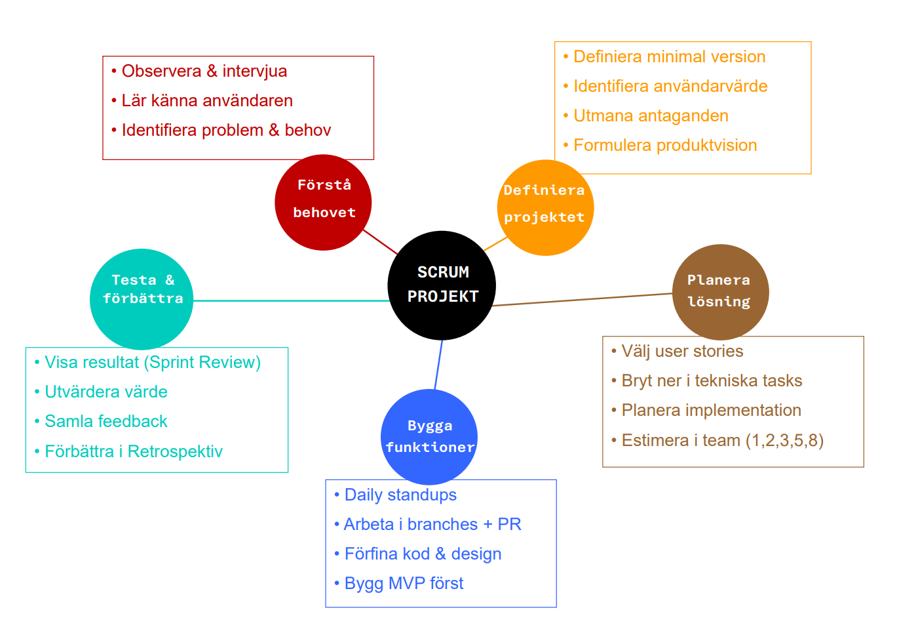

# Scrum-mapp

Den här mappen samlar all dokumentation kopplad till vårt Scrum-arbete i projektet **MINIL-Tech**.

## Innehåll

- `ideas.md`: resultatet från övningen *Produktidé*, där vi tog fram och valde spelidén.
- `product_vision.md`: vår långsiktiga produktvision för spelet och vilket värde det ska ge spelaren.
- `product_backlog.md`: användarcentrerad produktbacklogg med prioriterade user stories.
- `sprint_backlog.md`: plan för sprint 1 baserat på product backlog och våra estimat.
- `preparation_log.md`: logg över förberedelsearbetet innan sprinten startade.
- `common_evals.md`: våra referensuppgifter som används för estimat (Fibonacci-poäng).
- `daily-standups/`: dokumentation och skärmdumpar från våra Daily Standups under sprinten.
- `tech.md` / `tech.png` / `tech.excalidraw`: översikt över teknikval och en enkel skiss av arkitekturen.
- `Mindmap.png`: vår mind-map som visualiserar produktidén, tänkt användare, värde samt kopplingen mellan minimal och maximal version av spelet.

## Mind-map

Nedan visas vår mind-map.

