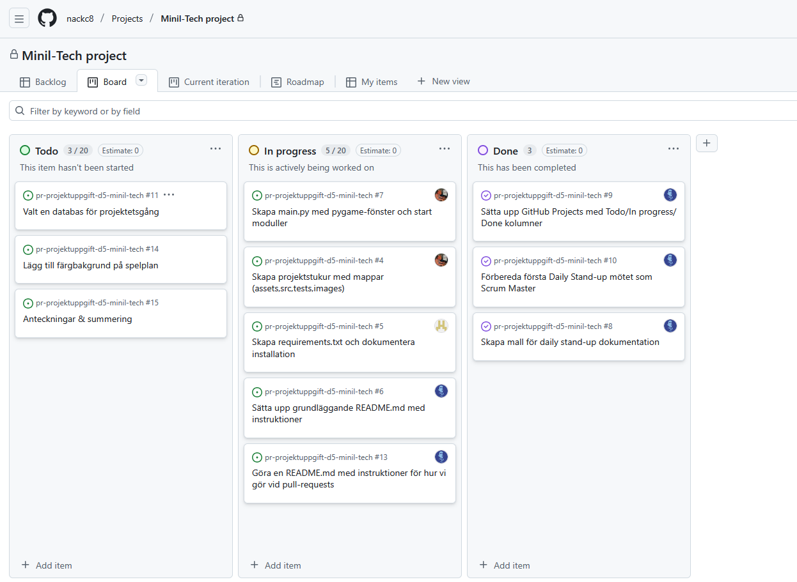

# Daily Stand-up - 02 December 2024

**Tid:** 08:15
**Plats:** Discord

## Närvarande
- Ikaros
- Issam
- Nila
- Love
- Markus

## Frånvarande
Ingen

### Ikaros

**Vad gjorde jag igår/senast?**
- Satte upp scrum-boarden och satt upp daily stands up-mallen

**Vad ska jag göra idag?**
- Börja arbeta på projektstrukturen

**Några hinder?**
- Inga hinder

---

### Issam
**Vad gjorde jag igår/senast?**
- Första mötet, ingen tidigare aktivitet

**Vad ska jag göra idag?**
- Ta uppgifter från To Do listan och börja arbeta på dem

**Några hinder?**
- Inga hinder

---

### Love
**Vad gjorde jag igår/senast?**
- Första mötet, ingen tidigare aktivitet

**Vad ska jag göra idag?**
- Börja arbeta på uppgifter från To Do listan

**Några hinder?**
- Inga hinder

---

### Markus
**Vad gjorde jag igår/senast?**
- Spannat in olika arbetsroller för projektet

**Vad ska jag göra idag?**
- Fortsätta med arbetsrollerna beroende på teamets behov

**Några hinder?**
- Inga hinder

---

### Nila
**Vad gjorde jag igår/senast?**
- Första mötet, ingen tidigare aktivitet

**Vad ska jag göra idag?**
- Arbeta på uppgifter från To Do listan

**Några hinder?**
- Inga hinder

---

## Scrum Board vid mötets slut

## Anteckningar
- Första sprinten påbörjad
- Fastställning av idé och vision för projektet
- Stukturering av arbetsroller inom teamet

