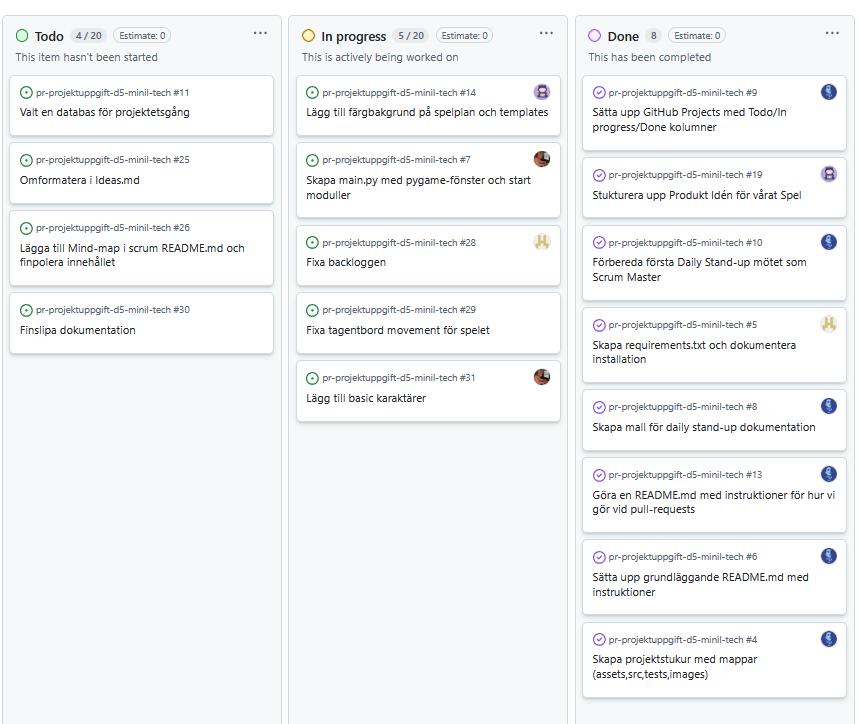

# Daily Stand-up - 03 December 2025

**Tid:** 08:15
**Plats:** Discord

## Närvarande
- Ikaros
- Love
- Markus
- Nila
- Issam

## Frånvarande
Ingen

---

### Ikaros
**Vad gjorde jag igår/senast?**
- Stukturerade upp mappar och filer för projektet.
- Skapade tutorial för PRs och branches.

**Vad ska jag göra idag?**
- Jobba vidare med ToDo-listan.

**Några hinder?**
- Inga hinder

---

### Love
**Vad gjorde jag igår/senast?**
- Studerade tutorials för Pygame och fixat requirements.txt.

**Vad ska jag göra idag?**
- Fortsätta arbeta med Pygame och ta något från ToDo-listan.

**Några hinder?**
- Inga hinder

---

### Markus
**Vad gjorde jag igår/senast?**
- Testade "Vibe koda" och kollade på tutorials för Pygame.

**Vad ska jag göra idag?**
- Se över ToDo-listan och börja arbeta på något av uppgifterna.

**Några hinder?**
- Inga hinder

---

### Nila
**Vad gjorde jag igår/senast?**
- Plockade tasks från ToDo-listan och fixade med Ideas.md och gjorde en Mind-map

**Vad ska jag göra idag?**
- Fortsätta med assignade tasks från ToDo-listan och fortsätta med dokumentationen.

**Några hinder?**
- Inga hinder

---

### Issam
**Vad gjorde jag igår/senast?**
- Gjorde main-framen för pygame spelet.

**Vad ska jag göra idag?**
- Fortsätta plocka tasks från ToDo-listan.

**Några hinder?**
- Inga hinder

---

## Scrum Board vid mötets slut

## Anteckningar
- Vi har alla börjat arbeta på uppgifter från ToDo-listan och projektet är i full gång.
- 