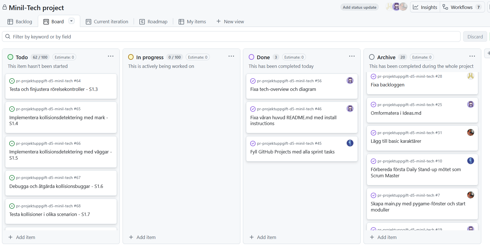

# Daily Stand-up - 04 December 2025

**Tid:** 08:15
**Plats:** Discord

## Närvarande
- Ikaros
- Love
- Markus
- Nila
- Issam

## Frånvarande
Ingen

---

### Ikaros
**Vad gjorde jag igår/senast?**
- Arbetade med GitHub Projects och strukturerade backloggen.

**Vad ska jag göra idag?**
- Fylla GitHub Projects med alla sprint tasks

**Några hinder?**
- Inga hinder

---

### Love
**Vad gjorde jag igår/senast?**
- Sturkurerade backloggen och planerade för kommande sprint.

**Vad ska jag göra idag?**
- Arbeta med spelkollisioner och implementera feedback från testning.

**Några hinder?**
- Inga hinder

---

### Markus
**Vad gjorde jag igår/senast?**
- Fixade med tagnetbordstyrning och testade olika lösningar.

**Vad ska jag göra idag?**
- Arbeta vidare med ToDo-listan

**Några hinder?**
- Inga hinder

---

### Nila
**Vad gjorde jag igår/senast?**
- Fixade med README.md filerna och dokumenterat en del.

**Vad ska jag göra idag?**
- Arbeta vidare med dokumentationen och ToDo-listan.

**Några hinder?**
- Inga hinder

---

### Issam
**Vad gjorde jag igår/senast?**
- Fixade player movements och mergade med main.

**Vad ska jag göra idag?**
- Arbeta med ToDo-listan.

**Några hinder?**
- Inga hinder

---

## Scrum Board vid mötets slut

## Anteckningar
-Omformatering av scrum board för bättre översikt.
- 
- Nästa Daily: NEXT_05 December 2025 08:15 på Discord
