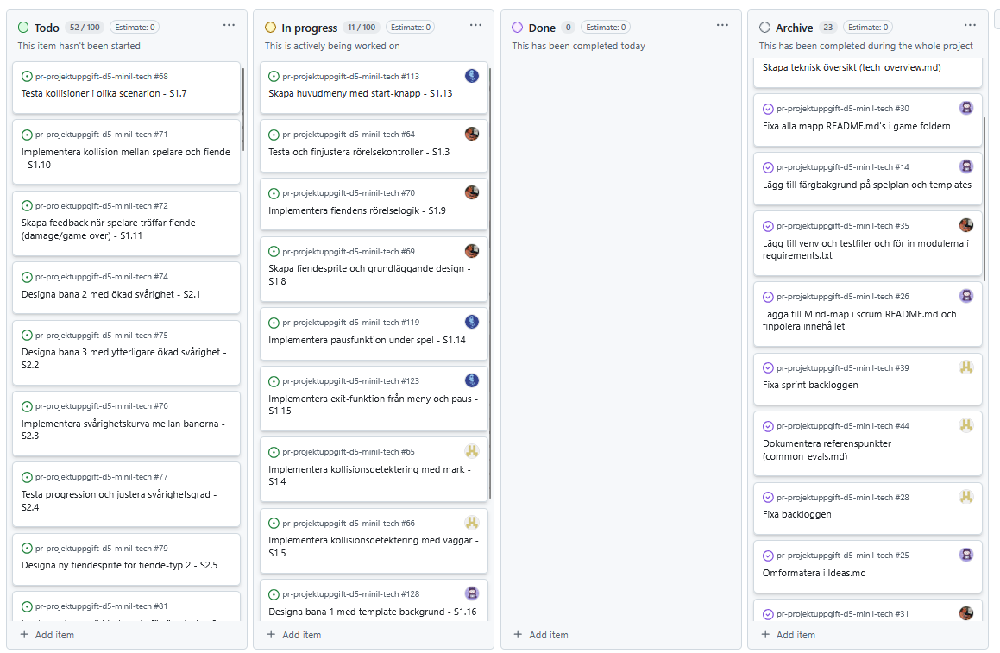

# Daily Stand-up - 05 December 2025

**Tid:** 08:15
**Plats:** Discord

## Närvarande
- Ikaros
- Love
- Markus
- Nila
- Issam

## Frånvarande
Ingen

---

### Ikaros
**Vad gjorde jag igår/senast?**
- lagt in sprint backloggen i ToDos på scrum board

**Vad ska jag göra idag?**
- Skapa huvudmeny och startknapp samt paus funktion

**Några hinder?**
- Inga hinder

---

### Love
**Vad gjorde jag igår/senast?**
- Fixa med sprint backloggen och user stories

**Vad ska jag göra idag?**
- Fixa med kollisionsdetektionen
**Några hinder?**
- Inga hinder

---

### Markus
**Vad gjorde jag igår/senast?**
- Hjälpte till med att lägga in ToDo:s på scrum boarden

**Vad ska jag göra idag?**
- Fortsätta ta tasks från scrum boarden

**Några hinder?**
- Inga hinder

---

### Nila
**Vad gjorde jag igår/senast?**
- Fixade main README.md-filen och hjälpte till med ToDo:s på scrum boarden

**Vad ska jag göra idag?**
- Designa bana 1 med template och tilemap

**Några hinder?**
- Inga hinder

---

### Issam
**Vad gjorde jag igår/senast?**
- Hjälpte till med att strukturera sprint backloggen på scrum boarden

**Vad ska jag göra idag?**
- Fixa med spelarens rörelse och animationer samt fienders AI

**Några hinder?**
- Inga hinder

---

## Scrum Board vid mötets slut

## Anteckningar
- Inga ytterligare anteckningar
- Nästa Daily: NEXT_05 December 2025 08:15 på Discord
