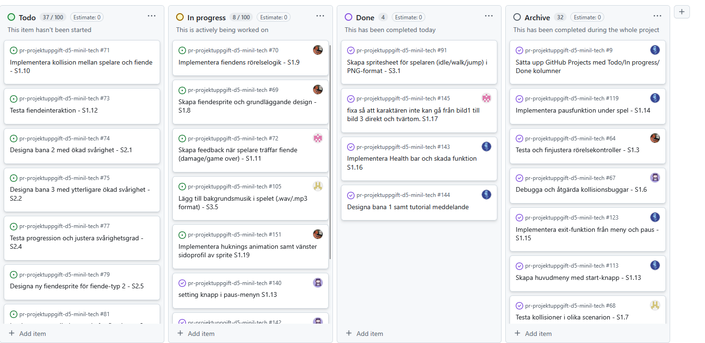

# Daily Stand-up - 08 December 2025

**Tid:** 08:15
**Plats:** Discord

## Närvarande
- Ikaros
- Love
- Markus
- Nila
- Issam

## Frånvarande
Ingen

---

### Ikaros
**Vad gjorde jag igår/senast?**
-Gjorde klart meny och paus fuunktionen

**Vad ska jag göra idag?**
- Göra klart ljud och musik och designa level 1

**Några hinder?**
- Inga hinder

---

### Love
**Vad gjorde jag igår/senast?**
- Fixa med obstacles och kollisionshantering

**Vad ska jag göra idag?**
- Implementera spel musik

**Några hinder?**
- Inga hinder

---

### Markus
**Vad gjorde jag igår/senast?**
- Ordnade med övergångar mellan de olika banornas templates

**Vad ska jag göra idag?**
- Fortsätta designa nivå 1

**Några hinder?**
- Inga hinder

---

### Nila
**Vad gjorde jag igår/senast?**
- Debuggade kolisionsbuggar i spelet

**Vad ska jag göra idag?**
- Designa nivå 1 med templates

**Några hinder?**
- Inga hinder

---

### Issam
**Vad gjorde jag igår/senast?**
- Stukade ihop spelarens rörelser och animationer

**Vad ska jag göra idag?**
- Fortsätta med spelarens rörelser och animationer och lägga till en huknings funktion samt en "slide" funktion

**Några hinder?**
- Inga hinder

---

## Scrum Board vid mötets slut

## Anteckningar
- Level 1 ska vara klar tills idag
- Nästa Daily: NEXT_08 December 2025 08:15 på Discord
