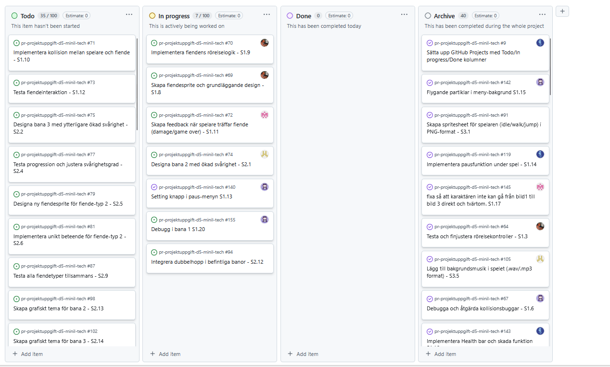

# Daily Stand-up - 09 December 2025

**Tid:** 08:15
**Plats:** Discord

## Närvarande
- Ikaros
- Love
- Markus
- Nila
- Issam

## Frånvarande
Ingen

---

### Ikaros
**Vad gjorde jag igår/senast?**
- Designade klart level 1

**Vad ska jag göra idag?**
- Fortsätta designa level 2

**Några hinder?**
- Inga hinder

---

### Love
**Vad gjorde jag igår/senast?**
- Lade till musik i spelet

**Vad ska jag göra idag?**
- Designa level 2

**Några hinder?**
- Inga hinder

---

### Markus
**Vad gjorde jag igår/senast?**
- Limiterade spelaren från att gå utanför banan och hoppa bland templates felaktigt

**Vad ska jag göra idag?**
- Fortsätta designa nivå 2 och ta todos från scrum board
 
**Några hinder?**
- Inga hinder

---

### Nila
**Vad gjorde jag igår/senast?**
- Fixade meny knappar och partikel effekter i main menu

**Vad ska jag göra idag?**
- Fortsätta debugga nivå 1 och sin ToDos från scrum board

**Några hinder?**
- Inga hinder

---

### Issam
**Vad gjorde jag igår/senast?**
- Fixade med animationer för spelkaraktären så som att ducka och dubbelhoppa

**Vad ska jag göra idag?**
- Fortsätta med enemies och deras AI

**Några hinder?**
- Inga hinder

---

## Scrum Board vid mötets slut

## Anteckningar
- 
- Nästa Daily: NEXT_09 December 2025 08:15 på Discord
