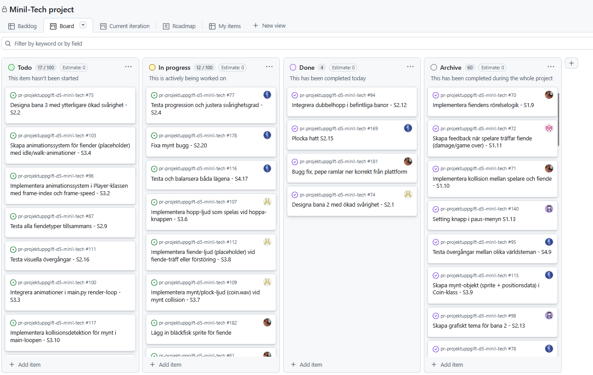

# Daily Stand-up - 11 December 2025

**Tid:** 08:15
**Plats:** Discord

## Närvarande
- Ikaros
- Love
- Markus
- Nila
- Issam

## Frånvarande
Ingen

---

### Ikaros
**Vad gjorde jag igår/senast?**
- Designat och pushat up en mainframe för level-2

**Vad ska jag göra idag?**
- Frotsätta med level-2

**Några hinder?**
- Inga hinder

---

### Love
**Vad gjorde jag igår/senast?**
- Hjälpte Ikaros med mainframen

**Vad ska jag göra idag?**
- Fortsätta med level-2

**Några hinder?**
- Inga hinder

---

### Markus
**Vad gjorde jag igår/senast?**
- Såg över små buggfixar

**Vad ska jag göra idag?**
- Arbeta med fiende kollision

**Några hinder?**
- Inga hinder

---

### Nila
**Vad gjorde jag igår/senast?**
- Frontend design för level-2 och sprites

**Vad ska jag göra idag?**
- Fortsätta med frontend design för level-2 och sprites

**Några hinder?**
- Inga hinder

---

### Issam
**Vad gjorde jag igår/senast?**
- Fixa obstacle buggar och "air gaps" mellan platform och spelaren

**Vad ska jag göra idag?**
- Fixa med fiende sprites och lägga till en template för fiender

**Några hinder?**
- Inga hinder

---

## Scrum Board vid mötets slut

## Anteckningar
- 
- Nästa Daily: NEXT_11 December 2025 08:15 på Discord
