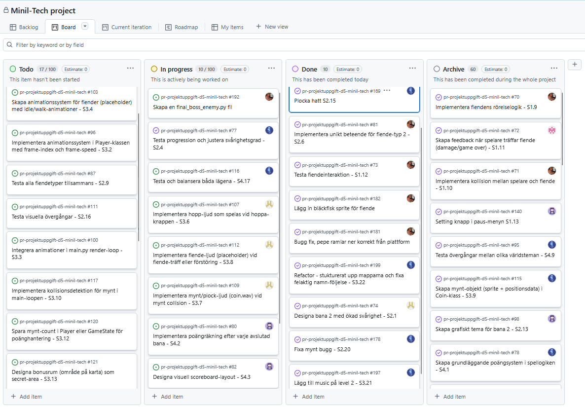

# Daily Stand-up - 12 December 2025

**Tid:** 08:15
**Plats:** Discord

## Närvarande
- Ikaros
- Love
- Markus
- Nila
- Issam

## Frånvarande
Ingen

---

### Ikaros
**Vad gjorde jag igår/senast?**
- Fixade buggar i level 2 som colletables och score counter. 
- La även till musik i level 2.

**Vad ska jag göra idag?**
- Justera fiende egenskaper och beteenden i level 2.

**Några hinder?**
- Inga hinder

---

### Love
**Vad gjorde jag igår/senast?**
-  La till ljud effekter för colletables 

**Vad ska jag göra idag?**
- Fortsätta med design för level 2

**Några hinder?**
- Inga hinder

---

### Markus
**Vad gjorde jag igår/senast?**
- Börjat omstukturera platformarnas positioner på level-2

**Vad ska jag göra idag?**
- Fortsätta med omstruktureringen

**Några hinder?**
- Inga hinder

---

### Nila
**Vad gjorde jag igår/senast?**
- Fixade en meny logan och knappar

**Vad ska jag göra idag?**
- Fortsätta med meny design och settings knappar

**Några hinder?**
- Inga hinder

---

### Issam
**Vad gjorde jag igår/senast?**
- Arbetade på fiende AI och deras rörelsemönster.

**Vad ska jag göra idag?**
- Börja på level 3 fiende boss

**Några hinder?**
- Inga hinder

---

## Scrum Board vid mötets slut

## Anteckningar
- 
- Nästa Daily: NEXT_12 December 2025 08:15 på Discord
