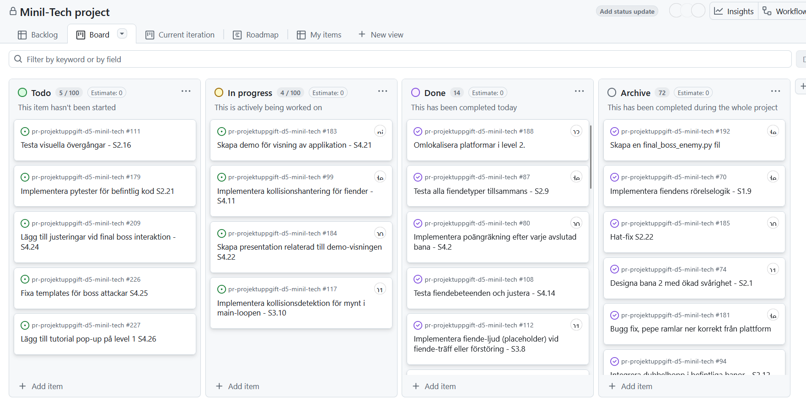

# Daily Stand-up - 15 December 2025

**Tid:** 08:15
**Plats:** Discord

## Närvarande
- Ikaros
- Love
- Markus
- Nila
- Issam

## Frånvarande
Ingen

---

### Ikaros
**Vad gjorde jag igår/senast?**
- Fixade med sista touchar på level 3 och boss attackerna samt ljudeffekterna.

**Vad ska jag göra idag?**
- Finslipa boss fighten och gör klart demo videon.

**Några hinder?**
- Inga hinder

---

### Love
**Vad gjorde jag igår/senast?**
- La till mynt kollisionsljud och fiende kollisionsljud.

**Vad ska jag göra idag?**
- Fixa med bossens attack templates.

**Några hinder?**
- Inga hinder

---

### Markus
**Vad gjorde jag igår/senast?**
- Fixat med en pop-up tutorial för level 1.

**Vad ska jag göra idag?**
- Fortsätta med pop-up tutorial och pytester.

**Några hinder?**
- Inga hinder

---

### Nila
**Vad gjorde jag igår/senast?**
- Score meny och json saving.

**Vad ska jag göra idag?**
- Fixa med templates och grafisk design för sista boss attackerna.

**Några hinder?**
- Inga hinder

---

### Issam
**Vad gjorde jag igår/senast?**
- Fixade med boss sprite och animationer.

**Vad ska jag göra idag?**
- Ändrat platforms positioner i level 3 för att göra det enklare.

**Några hinder?**
- Inga hinder

---

## Scrum Board vid mötets slut

## Anteckningar
- 
- Nästa Daily: NEXT_15 December 2025 08:15 på Discord
