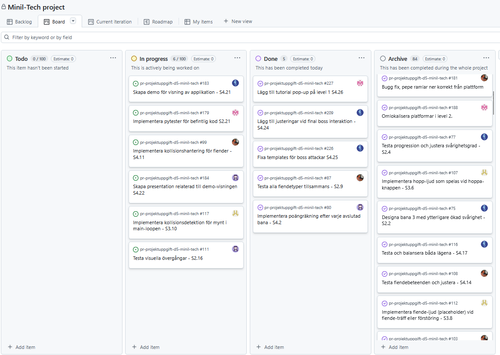

# Daily Stand-up - 16 December 2025

**Tid:** 08:15
**Plats:** Discord

## Närvarande
- Ikaros
- Love
- Markus
- Nila
- Issam

## Frånvarande
Ingen

---

### Ikaros
**Vad gjorde jag igår/senast?**
- Fixade med templates för level 3 och påbörjat med demo.

**Vad ska jag göra idag?**
- Göra klart demot.

**Några hinder?**
- Inga hinder

---

### Love
**Vad gjorde jag igår/senast?**
- Bidrog med grafiska templates för boss attackerna på level 3.

**Vad ska jag göra idag?**
- Fixa med scrum retroperspektiv leken.

**Några hinder?**
- Inga hinder

---

### Markus
**Vad gjorde jag igår/senast?**
- Implmenterade en pop-up tutorial för level 1.

**Vad ska jag göra idag?**
- Skapa pytester för spelets olika funktioner.

**Några hinder?**
- Inga hinder

---

### Nila
**Vad gjorde jag igår/senast?**
- Grafiska bilder för spelet överlag och arbete med presentationen för spelet.

**Vad ska jag göra idag?**
- Göra klart presentationen för spelet.

**Några hinder?**
- Inga hinder

---

### Issam
**Vad gjorde jag igår/senast?**
- Bidrog med grafiska templates för boss attackerna på level 3.

**Vad ska jag göra idag?**
- Fixa med scrum retroperspektiv leken.

**Några hinder?**
- Inga hinder

---

## Scrum Board vid mötets slut

## Anteckningar
- 
- Nästa Daily: NEXT_16 December 2025 08:15 på Discord
